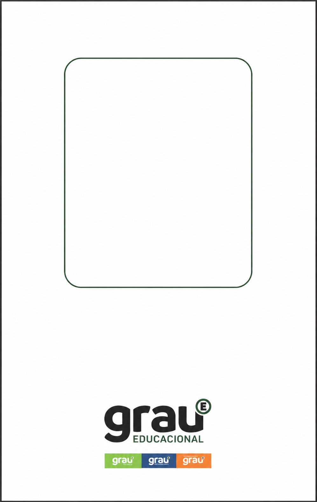

# Gerador de Crachás — Grau Educacional

Aplicação web local para criar, organizar e imprimir crachás do **Grau Educacional** no tamanho padrão de **5,5 × 8,5 cm**.

O gerador funciona diretamente no navegador, sem instalação, servidor ou conexão com a internet.

<p align="center">
  
  &nbsp;&nbsp;&nbsp;
  
</p>

## Funcionalidades

- Importação da foto do colaborador;
- Preenchimento do nome completo;
- Ajuste de zoom e posição da fotografia;
- Redimensionamento automático do texto para nomes longos;
- Pré-visualização em tempo real;
- Download do crachá individual em PNG;
- Modelo fixo de crachá **Em Treinamento**, sem foto e sem nome;
- Seleção da quantidade de cópias;
- Organização automática dos crachás em folha A4;
- Combinação de crachás personalizados e de treinamento na mesma folha;
- Remoção individual de itens adicionados à fila;
- Impressão ou salvamento da folha A4 em PDF;
- Processamento totalmente local, sem envio de dados para a internet.

## Como executar

### Opção 1 — Abertura rápida no Windows

1. Baixe ou clone este repositório.
2. Abra a pasta do projeto.
3. Execute o arquivo:

```text
Abrir_Gerador.bat
```

### Opção 2 — Abrir pelo navegador

Abra diretamente o arquivo:

```text
Gerador_de_Crachas_Grau_Com_Treinamento.html
```

Recomenda-se utilizar uma versão atualizada do **Google Chrome** ou **Microsoft Edge**.

## Criando um crachá personalizado

1. Clique em **Selecionar foto**.
2. Escolha a imagem do colaborador.
3. Digite o nome completo.
4. Ajuste o zoom e a posição da foto.
5. Informe a quantidade desejada.
6. Escolha uma das opções:
   - **Baixar PNG individual**;
   - **Adicionar à folha A4**.

## Adicionando um crachá de treinamento

1. Informe a quantidade desejada.
2. Clique em **Adicionar treinamento à folha**.

Esse modelo não exige nome nem fotografia.

Também é possível utilizar **Baixar PNG de treinamento** para obter apenas a imagem individual.

## Impressão em folha A4

O sistema organiza automaticamente até **9 crachás por página A4**.

Utilize estas configurações na janela de impressão:

| Configuração | Valor |
|---|---|
| Papel | A4 |
| Orientação | Retrato |
| Escala | 100% ou Tamanho real |
| Margens | Nenhuma ou mínima |
| Cabeçalhos e rodapés | Desativados |
| Gráficos de plano de fundo | Ativados |
| Tamanho de cada crachá | 5,5 cm × 8,5 cm |

> Antes de imprimir várias unidades, recomenda-se fazer uma página de teste e conferir as medidas com uma régua.

## Estrutura do projeto

```text
.
├── Abrir_Gerador.bat
├── Gerador_de_Crachas_Grau_Com_Treinamento.html
├── Modelo_Cracha_Personalizado.png
├── Modelo_Cracha_Treinamento.png
└── README.md
```

## Tecnologias utilizadas

- HTML5;
- CSS3;
- JavaScript;
- Canvas API;
- FileReader API;
- Recursos nativos de impressão do navegador.

Não há dependências externas, bibliotecas adicionais ou processo de instalação.

## Privacidade

As fotos e os nomes utilizados no gerador são processados somente no navegador do computador.

Nenhuma informação é enviada para servidores externos.

## Publicação no GitHub Pages

Para disponibilizar o gerador por meio do GitHub Pages:

1. Faça uma cópia do arquivo principal e renomeie para:

```text
index.html
```

2. Envie os arquivos para um repositório do GitHub.
3. No repositório, acesse **Settings → Pages**.
4. Em **Build and deployment**, escolha a publicação pela branch principal.
5. Selecione a pasta raiz do repositório e salve.

> Ao publicar o projeto, confirme previamente se as imagens, logotipos e elementos visuais podem ser disponibilizados publicamente.

## Compatibilidade

O projeto foi preparado para navegadores modernos em computadores Windows.

Navegadores recomendados:

- Google Chrome;
- Microsoft Edge.

## Observações

- O arquivo HTML contém os recursos necessários para o funcionamento do gerador.
- Os arquivos PNG presentes no projeto servem como referência visual dos modelos.
- Para preservar as dimensões físicas do crachá, evite opções como **Ajustar à página** ou escalas diferentes de 100%.
